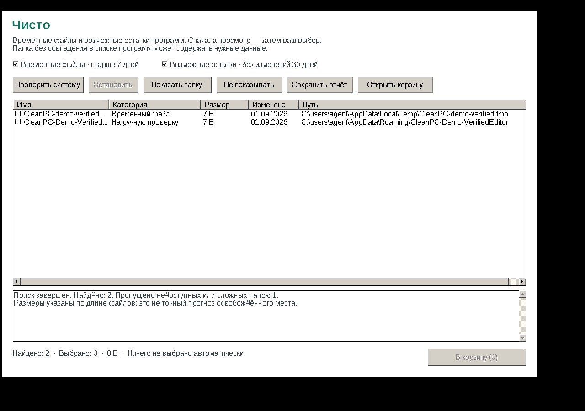

# Чисто · CleanPC

Небольшое portable-приложение для Windows 11 x64: временные файлы и возможные остатки удалённых программ. Русский интерфейс; установка, Python и PowerShell не нужны.

[Скачать приложение ZIP](https://github.com/harabassment/wincl/raw/refs/heads/cleanpc-v1/dist/CleanPC-Win11.zip) · [Скачать EXE](https://github.com/harabassment/wincl/raw/refs/heads/cleanpc-v1/dist/CleanPC.exe) · [Исходники ZIP](https://github.com/harabassment/wincl/raw/refs/heads/cleanpc-v1/dist/CleanPC-source.zip)

Распакуйте ZIP и запустите `CleanPC.exe`. Сборка не подписана цифровым сертификатом.

## Использование

1. Нажмите «Проверить систему». Поиск ничего не удаляет.
2. Выберите строку и прочитайте причину. Двойной щелчок или «Показать папку» открывает расположение.
3. Отметьте только проверенные ненужные объекты. Автоматического выбора нет.
4. Нажмите «В корзину» и подтвердите. Восстановление — через корзину Windows.

Пока корзина не очищена, место на диске не освобождается.

## Область поиска

- Файлы в пользовательской папке Temp, созданные и изменённые более 7 дней назад.
- Папки первого уровня в Local AppData, Roaming AppData и ProgramData, без новых/изменённых объектов за 30 дней и без совпадений с названиями и издателями из списков удаления, папками Program Files, путями установки и исполняемых файлов процессов.

**Возможный остаток — не гарантированный мусор.** Здесь могут быть данные portable-программы, игры, общие компоненты, настройки и сохранения. Приложение не гарантирует полноту поиска или отсутствие ложных находок. Проверяйте содержимое перед выбором.

Системные и некоторые общие папки исключены. Ссылки, недоступные деревья и облачные placeholders пропускаются. Перед очисткой повторно проверяются идентификатор объекта, возраст, размер, количество файлов, последняя запись и занятость. При ошибке корзины удаления без неё нет. Реестр читается для списка программ; очистки реестра нет.

Исключения и журнал: `%LOCALAPPDATA%\CleanPC`. Подробная инструкция — [README-RU.txt](dist/README-RU.txt). Контрольные суммы — [SHA256SUMS.txt](dist/SHA256SUMS.txt).

## Проверки и ограничения

Проверены правила отбора, границы путей, возраст, идентификаторы, блокировка занятого файла, символические ссылки, тестовые сценарии поиска, исключения и остановка. Тесты файлов и окно запускались через Wine 10. В тестовой Wine-среде корзина не поддержалась: исходный файл остался на месте. **Непосредственно на Windows 11 сборка пока не проверена.**



## Повторная сборка

Нужен Zig 0.13.0. На Windows запустите `src/build.cmd`. На Linux:

```sh
cd src
zig rc /fo app.res app.rc
zig c++ -target x86_64-windows-gnu -std=c++17 -O2 -static -s -municode main.cpp app.res -o CleanPC.exe -lcomctl32 -lshell32 -lole32 -luuid -ladvapi32 -lcomdlg32 -luxtheme -lgdi32 -luser32 -Wl,--subsystem,windows -Wl,--nxcompat -Wl,--dynamicbase
```

Исходники тестов находятся в `src/test_*.cpp`; проверки не отключаются оптимизатором (`src/check.h`).
